> ITL 战队算法组培训——2027 秋季
> 第三讲（上） 相机取流与图像处理

*ai使用的讲述会放在本讲，ai可以使我们的效率提升几倍、十几倍甚至几十倍，但是这个效率，是什么的效率呢？不仅是我们写作业的效率，推进度的效率，它更应该是我们自身学习的效率*

# 0. AI 使用
[AI 使用入口（飞书）](https://vcnoo3ag4wib.feishu.cn/wiki/Yq4lwZuA6iwhRkk8iGgchoA9ntg?from=from_copylink)。需要核对接口说明时，可直接查阅 [OpenCV 4.x 图像处理文档](https://docs.opencv.org/4.x/d7/dbd/group__imgproc.html)

之后的讲义内容较多、较难，均会分为上下两周，各交一份作业，沿用同一个工程。对于本讲，上下两周的终点是在基地对真实相机流进行实时装甲板识别。第一周会安排大家先解决相机取流的问题

# 1. 一帧图像是怎样形成并交给程序的？
把印有两条细黑竖线的白纸放在相机前。假设程序收到了一幅 `1280×960` 的图，放大后却只看到一条灰带。为什么一张尺寸正确、完整交付的图像，会分不开纸上的两条线？

## 1.1 曝光结束时，一个感光单元里有什么？
白纸和黑墨反射的光都经镜头汇聚到传感器上。对好焦时，两条黑线在像面上对应两条较暗的窄带。传感器的感光面不是连续读数的平面，而是由大量具有物理面积的感光单元排成的阵列。若某个单元一半落在暗带内、一半落在亮纸面上，它只能给出**一个**综合测量值，无法分别报告两半各有多亮；因此即便纸上没有灰墨，边缘处也会测出介于黑白之间的灰度值

曝光期间，硅吸收的部分光子会产生可收集的光电子。一个单元积累的**光电荷**反映的是整个曝光窗口内落在其感光面积上的总入射光，而非曝光结束瞬间的瞬时亮度。在照明不变且尚未饱和的条件下，曝光时间加倍，平均收集的光电子数也近似加倍。如果曝光期间纸面在移动，黑线会先后扫过不同单元；即便镜头始终对焦，边缘依然会被拖宽

**曝光结束留在传感器里的是电荷，并不是现成的 0～255 灰度值。** 在典型读出节点，电荷会改变电容上的电压；电容一定时，电荷量越大，电压变化幅度越大。模数转换器（ADC）再将模拟电压量化为有限个离散等级，输出对应的数字码。以 12 位线性原始输出为例，单个样本可表示为 0～4095。此外，对于常见的单传感器 Bayer 彩色相机，每个感光位置只测量单一滤色片透过的光，程序看到的三个颜色分量还往往经过了邻域重建；滤色阵列与颜色重建的例子见[第一讲第 2.2.4 节](第一讲%20计算机视觉.md)

## 1.2 CCD 和 CMOS 怎样读出一幅图？
两类传感器都能积累光电荷，最终也都输出数字读数，差异在于电荷如何转换为电信号并被读出

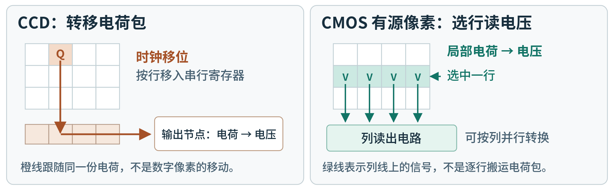

*图 1a：左图沿橙箭头跟踪一个电荷包；右图沿绿箭头跟踪选中行的电压信号。方格表示感光位置，未画全像素电路和 ADC*

- **CCD（电荷耦合器件）**：图 1a 中的 Q 表示单个感光单元积累的电荷包。读出时，时钟电压改变相邻势阱电势，使各格电荷包按固定顺序逐级转移；一整行电荷进入串行寄存器后，再逐个送至输出节点转换为电压，供后续放大与数字化。电荷虽然离开了原始感光位置，但移位顺序固定已知，因此读出的数值仍能准确对应回原来的行列。图中只画出一个输出口，实际 CCD 也可以分区并行使用多个输出口
- **CMOS 有源像素传感器**：CMOS 指互补金属氧化物半导体工艺。常见的有源像素在单元内部或邻近几个像素共享的节点上直接将光电荷转为电压，并由晶体管缓冲该信号。行选电路选通某一行后，该行各像素的电压经各自列线送往列读出电路；许多芯片在列端并行完成模数转换，再组织为数字输出。像素内部仍可能存在短距离电荷转移，但无需像 CCD 那样将每个电荷包跨越多行一路移至统一出口。需要注意，**“有源像素”并不意味着每个像素格都有独立 ADC**。想了解具体像素电路，可选读 [Fossum 与 Hondongwa 的器件综述](https://doi.org/10.1109/JEDS.2014.2306412)

**读出的顺序不等于曝光的顺序。** 假设阵列只有四行，每行均曝光 2 ms。图 1b 左侧，四行都在 0～2 ms 内同时感光，随后保持采得的信号，允许电路逐行读取——这就是**全局快门**：即便第 4 行到 5 ms 才读出，纸在 2 ms 之后发生的移动也不会写进这一帧。右侧，第 1 行在 0～2 ms 感光，第 4 行推迟到 3～5 ms 感光——这是典型的**卷帘（滚动）快门**：当一条竖线横向移动时，上下行记录的是不同时刻的横向位置，直线在图中就会显得倾斜

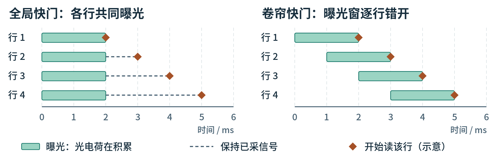

*图 1b：每段绿色横条都长 2 ms。判断快门方式应比较各行绿色曝光条的对齐关系，而非菱形读出时刻的位置。行间隔和读出时刻仅为示意，不对应特定相机参数*

逐行读出数据并不意味着一定是卷帘快门，CMOS 同样可以实现全局快门；反过来，即便使用全局快门使各行同时曝光，只要物体在 2 ms 曝光窗口**之内**移动，画面仍会产生运动模糊。判断具体型号应查阅传感器规格书中的快门模式，可对照[全局与卷帘曝光时序图](https://docs.baslerweb.com/electronic-shutter-types)

## 1.3 分辨率
相机接口给出的 `1280×960` 是**输出图像尺寸**：每行 1280 列，共 960 行，约 123 万个像素位置。将 `mono8` 改为同尺寸的 `bgr8`，每个位置的数据量从 1 个数变成 3 个数，但空间采样位置并未增多。同时，相机规格表上的最大有效像素数、本次采集输出的图像尺寸、查看器窗口的显示尺寸三者并不一定相同

要把“多少列”换算为纸面上的实际长度，还必须知道**横向视场**，即画面在该物距下覆盖多宽的纸面。作一个可手算的例子：纸面正对相机且忽略畸变，320 mm 宽的纸面恰好铺满原始 1280 列，则纸面上的采样间隔约为 `320 ÷ 1280 = 0.25 mm/列`，两条中心相距 1 mm 的竖线在图上约相隔 4 列。这个数值是**物面上的采样间隔**，既不是传感器相邻像元的物理中心距，也不保证相距 0.25 mm 的两条线一定可分辨

现在从同一张原图出发，有两种方式得到 `640×480` 的输出：

| 怎样得到 640 列 | 还看得到多宽的纸面？ | 原来相距 1 mm 的两条线在新图里呢？ |
| --- | --- | --- |
| 只裁出中央 640 列（ROI），不缩放 | 160 mm，左右两侧被裁掉 | 若两条线都在裁区内，中心仍约相隔 4 列 |
| 保留整个视场，每 2×2 格平均为一格 | 仍是 320 mm | 中心间隔折算为约 2 列，线与纸的亮暗差也可能被平均掉 |

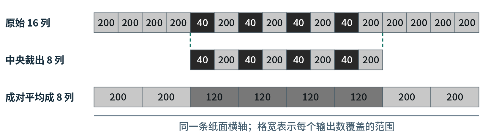

*图 1c：把上例缩成一行 16 格。中央 8 格是交替的 40 和 200；裁出它们，明暗仍交替。若每两格平均一次，全行同样输出 8 格，中央四格却全是 120。格宽按同一纸面比例绘制，数值为构造例*

**系统的空间分辨能力**问的是：在给定的对比度、拍摄条件与判据下，纸面上相距多近的两处结构仍能区分？对两条黑竖线，可以沿同一行读取灰度：两处暗谷之间是否仍存在可重复的亮峰，而非单次噪声波动？如果光学失焦已经使两条暗带在像面上混成一条，即使采样更密，得到的也只是更多相近的灰值；如果细纹像图 1c 那样在采样合并时被平均成常量，事后再放大窗口也恢复不了原来的明暗交替

用等宽黑白条纹测试时，一条黑纹加一条白纹称为一个**线对**。上例每毫米采样 4 次，若纸上每毫米印有 2 个线对，则每个黑白周期只分配到 2 个采样格。假设每格均匀感光且格中心恰好落在黑白交界处，每个格都会各取半黑半白，最终读数完全一致。可见，`0.25 mm/列` 是由视场与列数算出的几何采样间隔，本身不能作为系统实测可分辨 `2 线对/mm` 的证据

图 1c 中央的 8 格交替细纹还能说明另一类降采样风险：如果不做两格平均，而是直接隔列抽取（隔点采样），从第 1 格起抽出的结果全是 40，从第 2 格起抽出的结果全是 200——采样不足时，简单抽点同样会丢掉细纹，甚至使结果强烈依赖起始偏移。要亲自检验图 1c 的结论，可在固定纸面、相机和照明后保存一张对好焦的原图，在软件中分别做中央裁切和全图减半，沿**同一对纸面线条**对比灰度分布（该实验不要求相机支持硬件合并）

## 1.4 数字读数怎样成为程序收到的帧？
本讲涉及的相机将同一次采集得到的二维样本组织为**一帧**；如图 1b 所示，这并不要求所有行在同一时刻曝光。数字数据经 USB 或以太网等接口传输，主机端的驱动或厂商 SDK 按协议接收并组帧。对于按完整帧交付的接口，程序拿到的是**像素缓冲区及其元信息说明**。说明至少要明确行数、列数、每行字节排列方式以及像素格式编码——例如同样是 12 位样本，既可以每个样本占 2 字节存储，也可以将相邻两个样本紧凑装入 3 字节；仅知道 ADC 位数，无法正确解析这块内存布局

打开设备只表示取得了访问句柄。程序开启采集后，需要按 SDK 接口主动等待帧到达或注册回调函数；只有当接口返回成功并交付有效数据时，程序才真正拿到一帧图像。若相机被配置为外部触发模式，在未收到触发信号前通常不会有帧交付

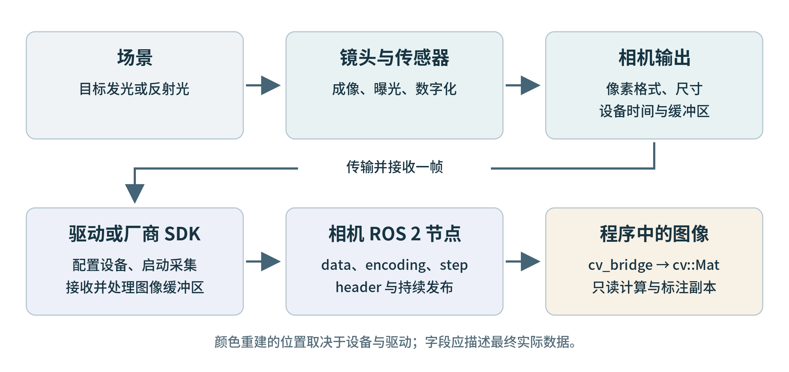

*图 1d：采集程序调用 SDK 取得这一帧，再作为 ROS 2 节点发布。右端的查看器或处理程序消费的是 ROS 2 消息，订阅话题不能代替从相机取帧*

在编写实际取流程序时，需注意以下三类问题：

- **全黑帧与取帧超时不同**：取帧成功但像素全黑，说明链路已交付数据，应优先检查原始读数、镜头遮挡、光圈与曝光参数；取帧超时则根本没有新帧到来，不能把上一帧旧数据拿来重复计算
- **留样验证画面更新与缓冲区复用**：让纸面从左移到右并保存移动前后的原图，才能验证程序确实在读取新帧。若 SDK 交付的是内部借用缓冲区，在归还或下一次取帧后该内存可能被覆写——仅保存两个指针地址并不等于保存了两幅画面，留样必须在缓冲区有效期内完成写出或深拷贝
- **曝光时间不等于帧周期**：曝光时间描述单个感光单元积累光电荷的时长，而程序的实际收帧率等于观测时长（秒）内成功收到的不同帧数除以该时长，不能用循环执行次数或曝光时间的倒数替代

将该帧打包发布为 `sensor_msgs/msg/Image` 时，像素数据必须与消息元信息逐项吻合。以 2 列×2 行的 `bgr8` 图像为例，每行有效像素占 6 字节：若保留每行末尾的 2 字节内存对齐填充，则消息行步长 `step` 为 8，总数据长度 16 字节；若逐行紧密复制去掉填充，则 `step` 为 6，总数据长度 12 字节

回到第 1 节开头的问题：**两条细黑竖线之所以变成一条灰带，可能源于光学失焦、像元面积平均、曝光期运动拖尾，或是降采样合并——这些信息一旦在成像与采样阶段丢失，打包和后续软件字段都无法还原。** 相反，**打包不是重新成像**：如果取帧后直接保存的原图清晰可辨，发布成话题后却出现斜纹或行错位，则应优先核对消息的 `step`、宽高与像素格式编码

# 2. 图像在程序里是什么：坐标、彩色编码与内存视图
## 2.1 像素坐标、读写顺序与量化上限
一幅数字图像是定义在有限离散网格上的数值表 $I(u, v)$。约定原点位于图像左上角，横向列号 $u$ 向右增大，纵向行号 $v$ 向下增大，均从 0 开始编号

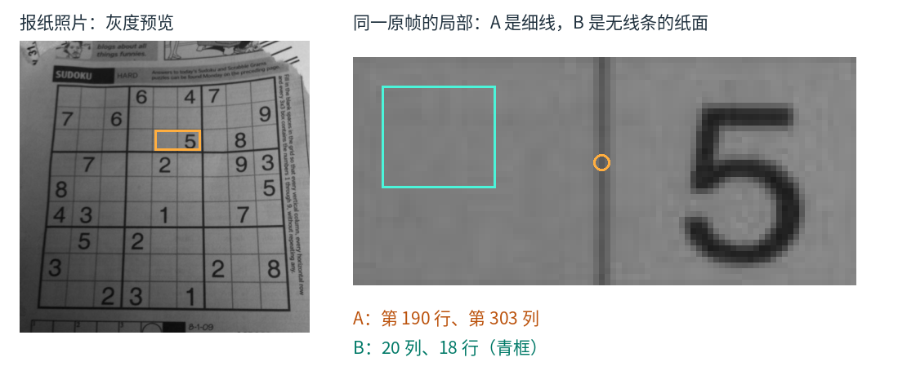

*图 2：左边是 OpenCV 公开数独报纸照片（558 列、563 行）的灰度预览，右边放大了橙框内的像素。橙圈 A 在细格线上，青框 B 是一小块没有印刷线的纸面*

将该原图按 BGR 解码，再以 `COLOR_BGR2GRAY` 转为 8 位灰度。点 A 的几何坐标是 $(303, 190)$：在彩色图中，调用 `bgr.at<cv::Vec3b>(190, 303)` 读到 `[85, 92, 87]`；在灰度图中，调用 `gray.at<uchar>(190, 303)` 读到 **90**。注意`cv::Mat::at(row, col)` 的参数顺序是先行号、后列号，与几何坐标 $(u, v)$ 恰好相反

采样决定了在哪些离散格点上取值，量化则将读数限制在有限个整数等级内。8 位无符号图像每个通道仅有 `0～255` 共 256 个等级。文件里读到的灰度是经过曝光、增益、传感器响应和解码之后的数字码，并不是入射光强的直接物理计量。**一旦两个亮度不同的区域在成像时都饱和截断到 255，后续无论怎样调暗整幅图，都只能得到相同的较小值，无法恢复原有的亮度差。** 做实验对照时必须读取未画标注的原图；同时，读文件失败返回的空 `cv::Mat` 不是有效的全黑图像，调用前必须判空

## 2.2 彩色通道、颜色特征与高亮度过曝
在 OpenCV 中，`CV_8UC3` 仅声明“每个像素占 3 个 8 位无符号整数”，**不自带通道排列语义**。这三个数究竟按 BGR 还是 RGB 排列，取决于读图接口或相机驱动的编码约定。把 RGB 图像当作 BGR 来算红蓝通道差，会把红色目标与蓝色目标直接颠倒

彩色转灰度是不可逆的多对一映射。OpenCV 的 `COLOR_BGR2GRAY` 近似按 $0.114B + 0.587G + 0.299R$ 取整。例如在 OpenCV 4.5.4 中，`BGR = (85, 92, 87)` 与 `BGR = (255, 92, 23)` 转换后都得到灰度 **90**。当任务需要区分颜色时，直接转灰度会丢掉关键判据

如果桌上同时放着红、蓝两种色样，想要在不丢颜色判据的前提下区分它们，工程中最常用下面两种特征：

- **通道差**：例如用 8 位无符号饱和减法计算 $R - B$（筛选偏红像素）或 $B - R$（筛选偏蓝像素）。饱和减法会把负值截断为 0，避免无符号整数下溢回绕到接近 255
- **HSV 颜色空间**：将颜色分解为色调 $H$、饱和度 $S$ 与明度 $V$。使用 OpenCV 默认的 `COLOR_BGR2HSV` 转换 8 位图像时，$H$ 的取值范围是 `0～179`（约以 2° 为 1 个单位），红色横跨这一循环范围的首尾两端，不能只用单段连续区间覆盖；$S$ 和 $V$ 的范围均为 `0～255`

需要注意高亮度过曝对颜色特征的影响：当发光区域的**三个通道都接近上限、画面趋近纯白**时，通道差与 HSV 饱和度都会同时丧失区分度；而如果**仅有部分通道发生截断**，通道之间的数值差异仍可能保留，因此不能把所有过曝一概而论。下表给出 OpenCV 4.5.4 对四个构造像素的计算结果：

| 构造示例 | BGR 值 | 灰度 | 饱和减法 $R-B$ | 饱和减法 $B-R$ | OpenCV 8 位 HSV |
| --- | --- | ---: | ---: | ---: | --- |
| 较纯的红色（未饱和） | `(30, 40, 220)` | 93 | 190 | 0 | `(2, 220, 220)` |
| 较纯的蓝色（未饱和） | `(220, 40, 30)` | 58 | 0 | 190 | `(118, 220, 220)` |
| 接近白色的高亮像素 | `(250, 250, 255)` | 251 | **5** | 0 | `(0, 5, 255)` |
| 完全饱和的白点 | `(255, 255, 255)` | 255 | **0** | **0** | `(0, 0, 255)` |

## 2.3 局部坐标、步长与共享内存
图 2 右侧的局部裁块取自原图第 260～347 列、第 172～211 行（宽 88、高 40）。在未放大的局部图中，点 A 的局部坐标为 $(303-260, 190-172) = (43, 18)$，读取第 18 行第 43 列依然得到 90。如果某段代码在局部 ROI 上算对了位置，映射回原图却整体平移了一个固定偏移量，应优先核对裁块原点偏移和缩放系数，而不是去改算法阈值。此外，为了便于观察而在屏幕上放大显示的预览图，不能作为像素测量输入

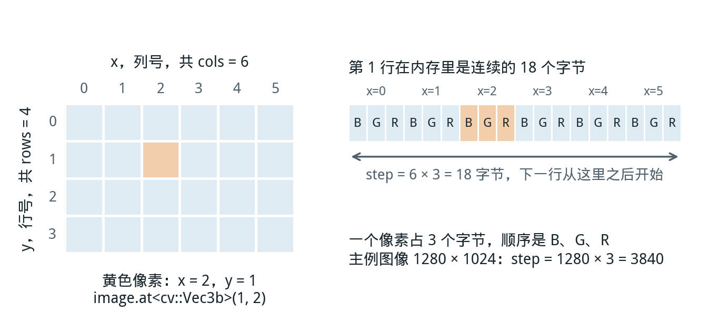

*图 3：以一幅仅有 6 列的小图示意内存布局。`step` 是相邻两行起点之间的字节数；对 ROI 视图而言，`step` 仍沿用原图行跨度，并不一定等于“列数 × 每像素字节数”*

在 OpenCV C++ 中，直接赋值 `cv::Mat marked = gray;` 与区域裁切 `cv::Mat roi = gray(region);` **都不会复制像素数据**，二者只创建新的矩阵头，仍指向同一块底层像素缓冲区

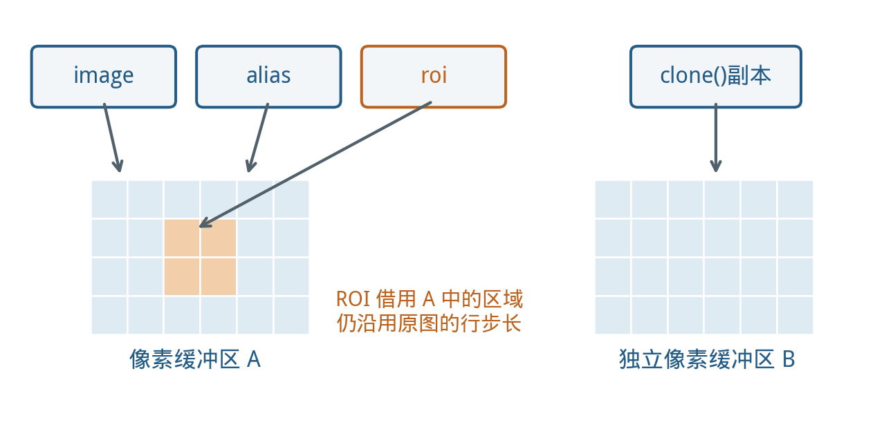

*图 4：浅拷贝与 ROI 共享同一片像素缓冲区；`clone()` 生成独立像素副本，`copyTo()` 将像素复制到指定目标矩阵*

因此，在 `marked` 上画框、画圆或叠加文字，会直接改写原图 `gray` 对应位置的像素；若随后继续拿 `gray` 做检测或读灰度，读到的将是自己画上去的标注色。**永远保留未修改的原图用于计算，在 `clone()` 出的独立副本上绘制可视化标注**

# 3. 邻域、滤波与分割：一切处理都是带代价的假设
回到图 2 的数独报纸。假设我们要把这张图处理得更利于提取印刷线：一方面希望略显斑驳的空白纸面 B 区更平整，另一方面又希望本就很淡的细格线 A 不要进一步变淡。对每个像素取周围几格灰度的均值，是最直观的想法。**在 A 和 B 上施加同一种平滑运算，这两个目标能同时满足吗？**

## 3.1 同样九个数，两种不同的输出
第二讲里，`40、60、80` 的均值是 60，结果是一个标量。把窗口放到图像上逐像素滑动，每次都从**原图**读取窗口内的像素，并将结果写入**新图**的对应中心位置，输出就仍是一幅图像

**邻域**是指相对于当前像素选取的一组参与运算的位置；对邻域像素做线性加权求和时，各位置的权重构成**滤波核**。以 A `(303, 190)` 为中心的 3×3 原始灰度如下（方括号标出中心像素）：

```text
111   90   103
110  [90]  105
111   90   106
```

针对这九个数，可以提出两个截然不同的问题：

- **这附近平均有多亮？** 九数之和为 916，局部均值 $M = 916 / 9 \approx 101.78$。两侧较亮的纸面参与了平均，使原本为 90 的暗线位置变亮；若九格原本全是 80，均值仍是 80
- **中心比附近更亮还是更暗？** 计算局部差值 $D = I - M = 90 - 916 / 9 \approx -11.78$。负号表示中心暗于周围；在均匀为 80 的区域里，$D = 0$

本实验先将 8 位灰度转为浮点类型再计算均值与差值。若直接对无符号 8 位类型做饱和减法，$-11.78$ 会被截断为 0，与“中心等于周围均值”彻底混为一谈，事后再转浮点也无法恢复符号信息

从权重分布看，$M$ 的九个权重均为 $1/9$（总和为 1），属于**低通平滑**；$D$ 给中心分配 $8/9$、其余八格各分配 $-1/9$（总和为 0），属于**高通滤波**（此处的高频/低频指灰度随**空间位置**变化的快慢，而非相机帧率）。如果九个像素原本应具有相同真值，仅叠加了互不相关、零均值、方差为 $\sigma^2$ 的随机误差，九点平均可将误差方差降至 $\sigma^2 / 9$。但**细线处违背了这一核心前提：窗口内的九个像素原本就不该一样亮**。均值滤波并不会先区分暗像素究竟是噪点还是目标笔画

## 3.2 在同一条件下的实测对照
在整幅原灰度图上分别施加 3×3 和 7×7 均值滤波（各自作用于原图，而非串联），统一按以下三项指标测量：

- **B 区纸面起伏**：左上角 `(265, 177)`、宽 20、高 18 共 360 个像素的总体灰度标准差
- **细线与两侧灰度差**：第 190 行上，第 296、310 两列纸面灰度的均值减去第 303 列（A 处）的灰度
- **最暗列位置**：第 190 行第 296～310 列中灰度最小的列号

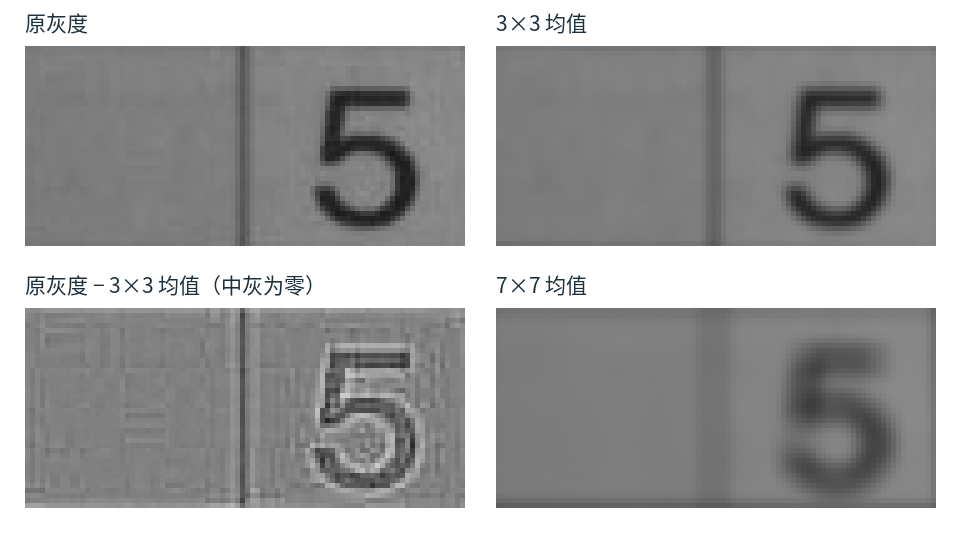

*图 5：3×3 和 7×7 分别作用于同一幅原灰度图。左下格为便于显示做了 `128 + 4D` 的线性拉伸（中灰代表 0）；下表数值均取自显示变换之前*

| 处理方式 | A 处灰度 | B 区纸面起伏 | 细线与两侧灰度差 | 第 296～310 列最暗列 |
| --- | ---: | ---: | ---: | ---: |
| 不滤波（对照） | 90.00 | 2.04 | 40.00 | 303 |
| 3×3 均值 | 101.78 | 1.66 | 28.39 | 303 |
| 7×7 均值 | 115.69 | 1.33 | 13.52 | 302 |

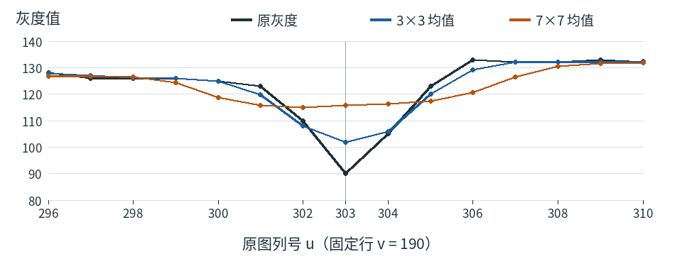

*图 6：沿第 190 行的灰度剖面*

实测结果清楚地呈现了一项权衡：7×7 均值把纸面起伏从 2.04 降到了 1.33，却同时把细线对比度从 40.00 压低到 13.52，按同一规则找出的“最暗列”也从 303 偏移到了 302。**这并不证明真值一定在第 303 列，而是说明：改动前置处理后，沿用同一测量规则得到的几何读数可能随之变化。** 此外，标准差变小也不等于单独测出了相机降噪效果，因为纸纹与光照起伏同样包含在读数中

非线性滤波同样存在适用边界。把 A 处的 3×3 九格排序取中值，结果是 **105**（比均值 101.78 还要亮），因为 90 在九格中只占三格。中值滤波擅长抑制孤立的单点极值，却不能保证保住细窄笔画

局部线性高通差值 $D$ 也有自身的表达局限：例如在三行均为 `60、80、100`（从左到右单调变亮）的区域上，中心像素与邻域均值均为 80，此时 $D = 0$；更一般地，只要一道硬阴影边缘与一道目标笔画在 3×3 窗口内呈现相同的灰度分布，任何仅依赖这九格的确定性运算必然输出完全相同的响应。**“响应强”是关于像素灰度的陈述，“这里是目标”则是对物体的判断**

## 3.3 全局阈值失效与分层排错
**分割**为每个像素分配类别。二值分割输出一张**掩膜**：白色 255 表示“选中”，0 表示“未选中”，它不再保留入选像素原本有多暗。对判定式 `I < 100`，`[99, 100, 101]` 映射为 `[255, 0, 0]`，恰好等于 100 的边界像素不入选

先看一幅仅有四种灰度的合成图：受光区的纸面和印迹分别为 220、130，阴影区的纸面和印迹分别为 75、45

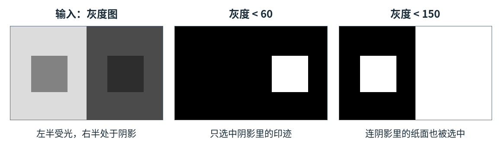

*图 7：受光处印迹（130）比阴影处空白纸面（75）更亮*

要保留受光印迹需要 $T > 130$，要排除阴影纸面又需要 $T \leq 75$。**这不是参数还没调细，而是满足条件的全局灰度阈值在数学上不存在。** 对整幅图施加任意单调递增的亮度或对比度变换，同样无法反转 75 与 130 的大小顺序

再回到数独报纸的真实照片。A `(303, 190)` 位于细格线上，另取左下方暗处空白纸面 C `(118, 475)`，对比“直接用 `I < 100`”与“先 3×3 均值再用 `< 100`”：

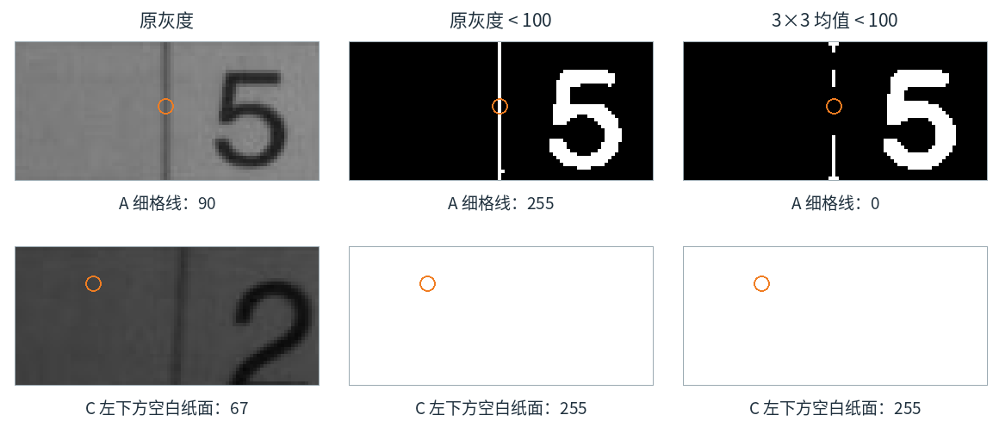

*图 8：上排为细格线 A，下排为暗处空白纸面 C；白色均表示选中*

| 位置与期望 | 原灰度 $I$ | 3×3 均值 $M$ | 局部差值 $D = I - M$ | 原灰度 `< 100` | 均值 `< 100` |
| --- | ---: | ---: | ---: | ---: | ---: |
| A `(303, 190)`，细线（应选） | 90 | 101.78 | -11.78 | 255（选中） | **0（漏选）** |
| C `(118, 475)`，纸面（应排） | 67 | 66.44 | +0.56 | **255（误选）** | **255（误选）** |
| 粗横线 `(280, 359)`（应选） | 30 | 31.78 | **-1.78** | 255（选中） | 255（选中） |

这张对照表能够把前置处理与分割规则各自引入的错误区分开来：

1. **A 的漏选来自前置平滑**：原图灰度 90 本可通过阈值，3×3 均值将其拉高至 101.78，跨过了阈值 100；去掉平滑即可修好 A
2. **C 的误选来自全局阈值假设失效**：暗处空白纸面灰度只有 67，比 A 处的细线还要暗，取消平滑也修不好 C
3. **局部差值 $D < -5$ 能同时分清 A 和 C，但不能就此收工**：将同一条规则放到同一张报纸的粗横线内部 `(280, 359)` 复验，该处原灰度虽低至 30，但周围也全是黑墨，3×3 均值是 31.78、$D \approx -1.78$，反而被漏选

由此可以总结出图像处理排查的核心方法——**不要只盯着最终输出盲目调参**：

- **按层定位首次偏离**：在同一坐标上依次记录“原图 → 中间图 → 掩膜”的数值，找出第一次偏离预期究竟发生在哪一步
- **用未调参样本复验**：每次修改规则后，必须拿到未参与调参的新位置或新图像上重新验证，避免只修好了眼前这一个点
- **无损保存中间数据**：用于核对数值的中间图应保存为无损 PNG（整数图），或直接打印、导出原始浮点数据；不要拿画了标注圈、做过显示拉伸或经过 JPEG 压缩的截图去量像素值

# 4. 本周作业：编写相机取流与发布节点
用 C++ 自行编写一个 ROS 2 相机节点，从真实工业相机连续取帧，并以 `sensor_msgs/msg/Image` 发布未标注的原图。可以调用厂商 SDK，本周不要求识别

- **实机验收**：现场画面变化时，自己发布的图像随之更新；节点正常退出能释放相机，按 README 重启后能恢复取流
- **同帧留样**：提交一张原图，附上该帧的话题名、分辨率、发布编码、保存格式、`header.stamp` 和 `header.frame_id`
- **工程材料**：提交源码、构建文件和 README，不含构建产物和日志。README 写明相机型号、采集接口与依赖、构建及启动方式、发布话题与 QoS、时间戳来源
- **多型号兼容**：同时兼容海康与迈德威视两种工业相机，所需厂商 SDK 自行查找

