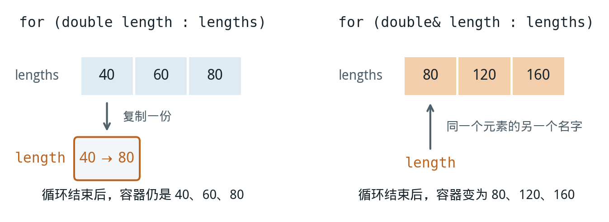
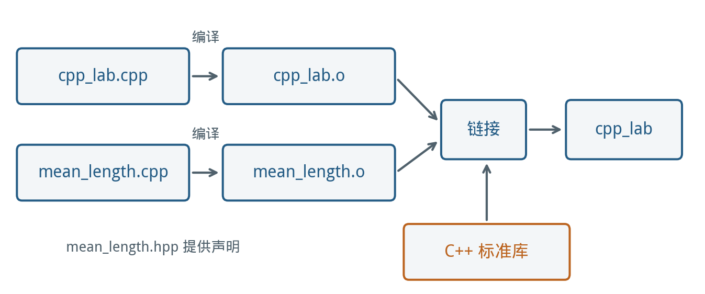
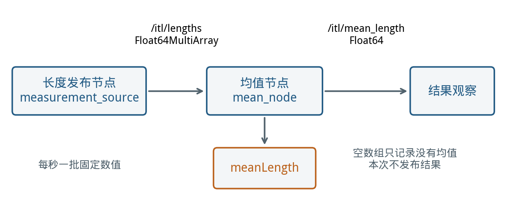
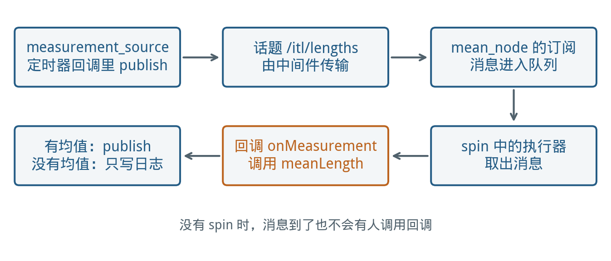

> ITL 战队算法组培训——2027 秋季
> 第二讲 Hello, World!

*首先聊一些大家应该都有疑惑的事情*

*现在AI这么强？为什么还需要学习编程？*

*我的核心看法是，正因为AI越来越强，我们才更应该学习编程。不过，学习编程的目的，不是单纯的学习、记忆编程语法、会写代码，而是学会如何利用计算机解决问题*

*AI 能够帮我们写代码，但它不能代替我们理解问题*
*AI 能够生成算法，但我们必须知道算法是否适合实际场景*
*AI 能够生成程序，但我们必须知道程序能否在真实机器人上稳定运行*

***AI 可以帮你写代码，但不能替我们承担机器人上场运行的责任***

*本质上，ai还是一种工具，需要人来进行使用，只不过ai的出现与发展，让我们不必把大量时间花在重复性的代码编写上，可以把更多精力放在系统设计、算法原理、工程实践和性能优化上*

# 0.  Hello, World!
**你好，世界！**

早在20世纪70年代，计算机科学家 Brian Kernighan (布莱恩·柯尼汉) 在编程教学材料中使用了输出 `hello, world` 的例子

1978年，他与 Dennis Ritchie（丹尼斯·里奇）合著的经典教材 The C Programming Language 进一步推广了这个传统

这里用cpp实现

```cpp
#include <iostream>
using namespace std;
int main()
{
    cout << "Hello, World!" << endl;
    return 0;
}
```
这就是大部分程序员的第一个程序，它的运行结果只是一串简单的字符`Hello, World!`
没有复杂的计算，也没有惊艳的功能，只是向世界打了一声招呼
这个梗却能流传至今，不仅仅在于技术
对于很多人来说，这是一个人第一次与数字世界建立联系，是他们和计算机世界的第一次握手

# 1. 培训事项说明
为什么会在这里说明这些呢？

对于RoboMaster算法组的成员来说，无一是不热爱技术、热爱机器人、愿意钻研学习技术的，也只有这样，才能成为一名合格的RMer，这个过程是艰难、耗时耗力的，大家应有相应的认识

我们的第零讲是导论与准备工作，第一讲虽然涉及了自瞄的传统检测流程，但是依旧是属于引入，讲概念的一讲，他们都没有严格正式的作业

从这一讲开始，之后的每一讲都有严格的作业要求，每一讲大家的作业完成情况将作为考核的一部分

除此之外，在培训中期，我就会发布一个门槛考核，大家需要在期末周之前完成，门槛考核不通过的，不参与最终的大作业考核

大作业将于最后一次培训公布，要求大家在期末考试后的一两周内完成并参与最终的答辩

每周的作业须于次周周六的18点前提交，在此之后的commit视为无效

# 2. 如何提问


提问的艺术：
https://bbs.robomaster.com/article/810096?source=1

真正的“第零课”：
https://www.bilibili.com/video/BV1om4y1H71S/?share_source=copy_web&vd_source=f28135794e3510563bee02668505aba8

# 3. 从检测流程到程序
第一讲中，我们从一帧装甲板图像出发，经过颜色差、阈值、闭运算、轮廓和几何筛选，得到了装甲板候选的四个图像点

当时所有计算都停留在纸面和配图上。要让机器人真的跑起来，这些计算得变成程序，于是有四个绕不开的问题：

- 一组灯条长度放在哪里？
- 一段计算怎样写成别人也能调用的函数？
- 写好的源文件怎样变成能运行的程序？
- 算出来的结果怎样交给另一个程序？

它们对应今天的三样工具

| 工具 | 它是什么 | 回答哪个问题 |
| --- | --- | --- |
| C++ | 一种需要先编译再运行的编程语言 | 数据放在哪里、计算怎样写成函数 |
| CMake | 构建系统的生成工具 | 源文件怎样变成程序 |
| ROS 2 | 一套机器人软件框架 | 结果怎样交给另一个程序 |

整讲只围绕一个很小的任务：

**假设上游已经量出一组灯条长度 40、60、80，单位是像素，求它们的均值**

答案是 60。任务小到不需要思考算法，我们才能把注意力放在工具上。不过有一个问题请大家先想一下：三个数的均值是 60，那么**零个数**的均值是多少？

# 4. 用 C++ 表达数据与计算
## 4.1 类型
C++ 里每个变量都有**类型**。类型规定了它能保存哪些值、占多少内存、能做哪些运算，定义时确定，之后不能改变

```cpp
int frame_index = 0;       // 整数
double length_px = 55.0;   // 浮点数，也就是带小数的数
bool accepted = false;     // 布尔值，只有 true 和 false
```

**类型只管数值，不管含义**。同一个 `double` 可以是像素，也可以是米，编译器不会替我们检查单位。所以变量名带上 `_px`、`_ms` 这样的后缀是一个好习惯。机器人上很多难查的错误，根源是两个人对同一个数的单位理解不同

**运算结果的类型由参与运算的类型决定**，和结果要存到哪里无关

```cpp
double a = 2 / 3;      // 两个整数相除，结果是整数 0
double b = 2.0 / 3;    // 有一个是浮点数，结果约为 0.666667
```

第一行不会报错，程序照常运行，只是结果是 0。程序不会崩溃，但是结果明显不是我们想要的

## 4.2 一组数放在哪里
一帧图像里有几根灯条，事先并不知道，所以需要一个元素个数可以变化的容器。标准库提供的是 `std::vector`

```cpp
std::vector<double> lengths{40.0, 60.0, 80.0};
```

尖括号里是元素类型，读作“元素为 double 的 vector”。它能告诉我们有几个元素、是不是空的，能按下标取元素，也能在末尾追加

下标从 0 开始，三个元素的合法下标是 0、1、2。访问 `lengths[3]` 能通过编译，运行时读到的却是不属于这个容器的内存，程序可能崩溃，也可能带着一个错误的数继续往下算

这里出现了第一个顶层的思路：**写下每一段代码时，都问一句，输入是空的会怎样？** 没有检测到灯条在比赛中是常态

## 4.3 值与引用
下面两个循环只差一个 `&`，都想把每个长度翻倍：

```cpp
for (double length : lengths)  { length *= 2.0; }
for (double& length : lengths) { length *= 2.0; }
```

第一个循环里，`length` 是一个新变量，每一轮把当前元素**复制**给它。翻倍的是副本，容器没有变化

第二个循环里，`double&` 表示 `length` 是一个**引用**。引用是已有对象的另一个名字，通过它读写的就是容器里的那个元素



*图 1：按值循环修改的是副本；按引用循环修改的是容器中的元素*

所以对 40、60、80 先后执行这两个循环，第一个之后均值仍是 60，第二个之后才变成 120

引用还有一个用途是避免复制。一个 `double` 只有 8 个字节，复制没有代价；一帧图像有几百万个像素，每传递一次就复制一次，程序会慢得无法使用。只想读、不想改时，写成 `const` 引用：不复制，也不允许修改

所以，在cpp工程中，看到一个参数需要关注：**它是副本还是本体？允许修改吗？**

## 4.4 函数与签名
把求均值的过程写成函数，别的代码就可以反复调用它

```cpp
double meanLength(const std::vector<double>& lengths);
```

这一行叫函数的**签名**，从左到右是：返回值的类型、函数名、参数列表。参数是上一节说的 `const` 引用，调用者只看这一行就知道：我的数据不会被复制，也不会被修改

签名是函数作者和调用者之间的约定。好的签名让人不读函数内部就能正确使用它

## 4.5 没有结果怎么表达
回到开头的问题。按上面的签名，传入空数组时函数里会发生 0 除以 0，得到的是 `nan`

`nan` 是 Not a Number 的缩写，表示这个浮点数不代表任何数值。它不会让程序停下，而是混在后续计算里一路传下去，任何数与它运算的结果仍是 `nan`。最后云台收到一个 `nan` 角度时，已经很难追查它是从哪里来的

那么空输入时返回 0 可以吗？也不行。调用者拿到 0，无法区分“均值恰好是 0”还是“根本没有数据”。就比如：像素 $(0,0)$ 是一个合法的位置，不能兼作“没有检测到目标”的标记

我们需要一种能表达“可能没有结果”的类型，标准库提供的是 `std::optional`。它要么装着一个值，要么是空的

```cpp
std::optional<double> meanLength(const std::vector<double>& lengths);
```

现在“可能没有结果”被写进了签名。调用者必须先检查有没有值，再去取值，想忽略这种情况都不太容易

这是本讲最重要的一个思路：**不要用一个合法的数值兼作“没有结果”的标记，把“没有”明确地表达出来**

## 4.6 结构体与类
一根灯条不只有长度。把属于同一个对象的几个量放在一起，需要用到**结构体**

```cpp
struct Light
{
    double length_px = 0.0;
    double width_px = 0.0;
};
```

`Light` 成了一个新的类型，可以像 `double` 一样定义变量、放进 vector、作为函数的参数和返回值。下一讲里，灯条和装甲板候选都是这样的结构体

有些对象除了数据，还要长期持有资源并对外提供操作，这时用**类**。类比结构体多强调一件事：哪些成员对外公开，哪些只供内部使用。把内部细节设为私有，外部代码就不会依赖它们，以后修改内部时不会牵连别人。本讲后半段的 ROS 2 节点就是一个类

## 4.7 对象存在多久
花括号围出一个**作用域**。在其中定义的局部变量，离开这对花括号时被销毁

由此得到一条规则：**引用和指针只是访问对象的途径，不负责让对象继续存在**。函数返回一个指向自己局部变量的引用，调用者拿到的就是一个已经不存在的对象

有的对象不能跟着某一对花括号结束，例如节点要从程序启动一直存在到退出，还同时被好几处代码使用。这时常用 `std::shared_ptr`，它是一种带计数的指针：记录有多少处在使用同一个对象，最后一处消失时自动销毁该对象

读 ROS 2 代码时会不断遇到 `SharedPtr` 这个名字。现阶段只需要会读：看到它，就知道这个对象由多方共同持有，不需要手动释放

# 5. 源文件怎样变成程序
## 5.1 编译和链接
源文件是给人读写的文本，可执行文件是给机器执行的指令。从前者到后者要经过两步

- **编译**：把一个源文件翻译成一个目标文件。每个源文件单独进行，互不知道对方的存在
- **链接**：把若干目标文件和库拼成一个可执行文件

改了源文件却没有重新构建，运行的仍然是旧程序

## 5.2 声明与定义
`meanLength` 以后既要被普通程序调用，也要被 ROS 节点调用，不能写在某一个程序自己的文件里，所以把它拆成两个文件

- **头文件**放**声明**：函数叫什么、怎么调用，也就是签名
- **源文件**放**定义**：函数具体怎么算

别的源文件要用这个函数，只需要包含头文件。编译器看到声明，就能检查调用是否正确，然后在目标文件里留下一个“这里需要 `meanLength`”的记号。真正的定义在哪里，是链接时才需要回答的问题



*图 2：每个源文件各自编译成目标文件，链接时才合在一起。头文件只提供声明*

## 5.3 报错先看阶段
理解了上面两步，报错就有了读法。拿到一个报错，先判断它出现在哪个阶段

| 阶段 | 典型现象 | 优先检查 |
| --- | --- | --- |
| 编译 | 找不到头文件 | 头文件路径、文件名和大小写 |
| 编译 | 名字未声明、类型不匹配 | 是否包含了头文件、参数类型 |
| 链接 | `undefined reference` | 实现文件或库是否参与链接 |
| 运行 | 找不到文件、结果不对 | 工作目录、输入数据、程序逻辑 |

编译阶段的报错带有源文件名和行号。链接阶段的报错来自 `ld`，没有源码行号

大家之后把报错发给 AI 之前，先自己判断是哪个阶段，问题的范围会小很多

## 5.4 CMake
实际工程有几十个源文件和好几个外部库，手写编译命令不现实

**CMake** 读取一份名为 `CMakeLists.txt` 的描述文件，再去调用编译器和链接器。描述三件事：**有哪些目标、每个目标由什么组成、谁依赖谁**

```cmake
add_library(itl_cpp_basics src/mean_length.cpp)
target_include_directories(itl_cpp_basics PUBLIC include)

add_executable(cpp_lab src/cpp_lab.cpp)
target_link_libraries(cpp_lab PRIVATE itl_cpp_basics)
```

这四行的意思是：`mean_length.cpp` 构成一个库，它的头文件在 `include` 目录；`cpp_lab.cpp` 构成一个可执行程序，它依赖这个库

库和可执行程序都叫**目标**，CMake 的描述是围绕目标展开的。读任何一个工程的 `CMakeLists.txt`，都先找出有哪些目标，再看它们之间的依赖

# 6. 用 ROS 2 连接程序
## 6.1 为什么需要 ROS 2
到目前为止，数据的产生、计算和输出都在同一个程序里。机器人上的软件不是这样组织的：相机驱动、检测、跟踪、串口通信通常是几个独立运行的程序，它们之间需要一种约定好的方式来传递数据

**ROS 2**（Robot Operating System 2）是一套机器人软件框架。名字里有 Operating System，但它不是操作系统，而是运行在 Ubuntu 之上的一组库和工具，最核心的功能就是让多个程序互相通信。我们使用的版本是 Humble

## 6.2 节点、话题、消息
- **节点**（node）：参与通信的一个运行单元，有自己的名字
- **话题**（topic）：一条有名字的数据通道。节点可以向话题**发布**消息，也可以**订阅**话题来接收消息
- **消息**（message）：在话题上传递的一份数据，它的结构由**消息类型**规定

把均值任务用 ROS 2 再做一遍，就是两个节点：



*图 3：发布节点每秒发出一组长度；均值节点收到后调用 meanLength，再把结果发布到另一个话题*

发布者和订阅者互相不知道对方是谁，它们只认话题的名字和消息类型。这带来一个很实用的性质：把数据源从“固定数值”换成“真实相机”时，订阅的一方不需要任何改动。队里调自瞄时用录像代替相机，靠的就是这一点

## 6.3 算法和通信分开
均值节点里没有重写一遍均值算法，它调用的就是第 4 节的那个 `meanLength`。节点只负责三件事：收消息、调用函数、把结果发出去

这样安排的好处在排错时体现：结果不对，先在普通程序里用固定输入检查算法，算法没问题，再去查消息有没有送到。两类问题不会搅在一起

“空数组没有均值”在这里第三次出现。均值节点收到空数组时，只写一条日志，**不发布任何东西**。它不发布 0，也不把上一次的结果再发一遍。没有结果，就不要制造一个结果

## 6.4 回调与 spin
节点是怎样“收到消息就计算”的？

我们写一个处理消息的函数，把它交给 ROS 2，并告诉它：这个话题上每来一条消息，就用这条消息调用它一次。像这样**交给别人、由别人在合适的时候调用的函数**，叫**回调**

那么是谁在调用？是 `spin`。程序的主函数创建好节点之后调用 `spin`，它不返回，一直循环等待，有消息到达就调用对应的回调，直到按下 Ctrl+C



*图 4：消息到达后先进入订阅者的队列，由 spin 取出并调用回调。没有 spin，回调永远不会执行*

所以一个 ROS 2 节点的基本形态是：**先登记好“什么事发生时调用什么函数”，然后把控制权交给 `spin`**。这与从上到下一路执行到底的程序是两种写法，刚接触时会不习惯

由此有两个推论。默认情况下回调是一个接一个执行的，某个回调迟迟不返回，后面的消息只能排队，所以回调里不要做很慢的事。另外，订阅者必须被节点长期持有，如果它只是某个函数里的局部变量，同第 4.7 节的讲述，函数一结束它就被销毁，订阅随之取消

## 6.5 话题存在，为什么还收不到
ROS 2 排错时最常见的现象是：话题明明在，订阅者却什么也收不到

话题名和消息类型一致只是必要条件，两端的 **QoS**（Quality of Service，服务质量）设置还必须相容。QoS 是一组通信策略，例如丢失的消息要不要重传。相容的规则可以概括成一句话：**发布者提供的不能比订阅者要求的差**

具体的策略见 [Humble 的 QoS 文档](https://docs.ros.org/en/humble/Concepts/Intermediate/About-Quality-of-Service-Settings.html)。收不到消息时按这个顺序排查：

1. 两个终端是否都加载了同一套环境
2. 完整的话题名是否一致
3. 消息类型是否相同，QoS 是否相容
4. 订阅者是否被长期持有，程序是否在 `spin`
5. 回调是否已经进入，只是在计算或发布时出了问题

# 7. 总结
本讲真正希望大家学习到的的是下面几条思路

- 类型只管数值，不管含义，单位要自己写清楚
- 每一段代码都问一句：输入是空的会怎样
- 不要用一个合法的数值兼作“没有结果”的标记
- 看到一个参数，先问它是副本还是本体、能不能改
- 报错先判断阶段：编译、链接还是运行
- 算法和通信分开，各自都容易检查
- 节点的形态是登记回调，然后交给 `spin`

# 8. 作业
可以查文档、用 AI，但提交的每一行代码都要能解释
## 8.1 C++ 与 CMake
新建一个 CMake 工程，实现两个函数：

1. `meanLength`：求一组长度的均值，空数组返回 `std::nullopt`
2. 统计一组长度中不小于给定阈值的个数，函数名和签名自定

要求：

- 声明放在 `include/` 下的头文件，定义放在 `src/` 下的源文件，编译成一个库
- 另写一个带 `main` 的程序链接这个库并测试两个函数，结果不对时返回非零值
- 测试输入要包含空数组和恰好等于阈值的长度

## 8.2 ROS 2
用 `ros2 pkg create` 新建一个包，写两个节点：

1. 发布节点：每秒发布一组长度，几组数据轮流发，其中一组是空数组
2. 均值节点：订阅这些长度，调用 8.1 的 `meanLength`，把均值发布到另一个话题；收到空数组时只打印日志，不发布

消息类型用 `example_interfaces` 的 `Float64MultiArray` 和 `Float64`，写法参考 [ROS 2 Humble 的 C++ 发布订阅教程](https://docs.ros.org/en/humble/Tutorials/Beginner-Client-Libraries/Writing-A-Simple-Cpp-Publisher-And-Subscriber.html)

每个终端先执行 `export ROS_LOCALHOST_ONLY=1`，避免收到别人节点的数据

## 8.3 提交
- 源码，不含 `build` 等构建产物
- 一份 README，写明：
    - 构建和运行的命令
    - 两个节点运行时的节点名、话题名、消息类型，以及每组输入对应的输出
    - 为什么空数组的均值不能返回 0
    - 遇到的问题和解决方案

检查时会要求现场修改一条计算规则或一个话题名
